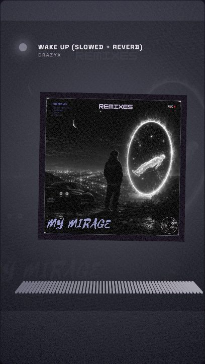
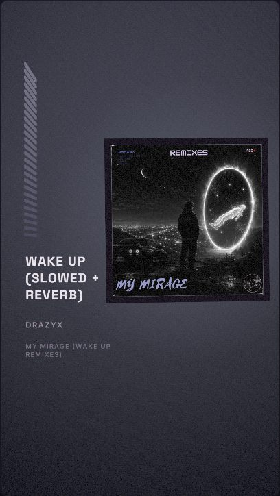
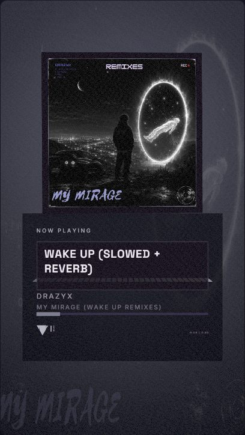

# Auditoria de qualidade audiovisual — DRAZYX VISUALIZER STUDIO

Data: 2026-11-25
Objeto: composições renderizadas no deploy, com capa real e áudio; um arquivo
exportado de 5,1 s. A avaliação é visual e técnica; não houve painel com
usuários nem análise quadro a quadro com ferramenta de sync.

## O que foi realmente avaliado

O deploy anuncia oito layouts, mas **apenas T3, T4 e T5 são aplicáveis**:

- T1 e T2 mantêm o MIRAGE (T1).
- T6, T7 e T8 mantêm o T5 (ALBUM PLAYER SPLIT).

Portanto, as capturas `layout-6/7/8` são do T5 e não devem ser lidas como
templates distintos. A avaliação de variedade é, na prática, de **três
composições + quatro estilos de cena**.

## Composições

### T1 — MIRAGE (também exibido ao clicar em T2)

- Capa suspensa central, halo, anéis espectrais, partículas.
- Boa sensação cinematográfica e foco na capa.
- **Problema grave de tipografia**: o título em duas linhas colide com o nome
  do artista (“DRAZYX”). O bloco de texto não se adapta ao comprimento.
- O texto “MY MIRAGE” aparece como eco grande no rodapé, com baixa opacidade;
  em alguns enquadramentos parece watermark acidental.
- CTA “LISTEN NOW · LINK IN BIO” visível, mas competindo com o eco.

### T2 — STEREO FRAME

- Na captura, é quase indistinguível do T1; as waveforms espelhadas prometidas
  não têm presença visual suficiente.
- A promessa do card (“waveforms à esquerda e à direita”) não se traduz em
  diferença perceptível.

### T3 — OFFSET CINEMA

- Composição editorial: badge e texto à esquerda, capa grande à direita,
  espectro na base. É a mais “capa de álbum” e a mais legível.
- Os textos “REMIXES” e “MY MIRAGE” ao fundo criam ruído atrás do bloco
  principal; em trechos claros, reduzem a leitura.
- Boa hierarquia e uso de espaço; a mais pronta para postar entre as três.

### T4 — EDITORIAL COVER

- Waveform vertical + texto à esquerda, capa à direita.
- Metade inferior vazia: a composição “flutua” no topo e perde peso.
- Boa para capas com muito espaço negativo, mas o vazio parece não intencional.

### T5 — ALBUM PLAYER SPLIT

- Capa à esquerda, player/progresso à direita; é a mais “produto”.
- O fantasma “MY MIRAGE” no rodapé parece um watermark de terceiros.
- Funciona bem em 9:16, mas o player pode parecer pequeno em telas de feed.

### T6–T8 — não avaliáveis

As capturas são o T5; não há evidência de composição própria no deploy.

## Movimento e ritmo

Observado ao vivo e no preview gravado:

- Partículas derivam lentamente; a capa flutua; anéis/variações de escala
  respondem ao sinal de áudio.
- O movimento é **contido e atmosférico**, coerente com “cinematográfico”.
- Não há cortes ou mudanças de cena por padrão; o storyboard é opt-in.
- Em 5 s, a composição tende a parecer um clipe estático com vida sutil. Para
  Reels/TikTok, isso pode reduzir retenção: falta um “evento” visual (revelação,
  mudança de escala, troca de cor, entrada de CTA) nos primeiros 1–2 s.

**Sincronia**: há reatividade ao áudio (energia/transiente), mas não foi medida
defasagem nem alinhamento de beat. Não é possível afirmar “sincronizado” em
sentido musical; a avaliação subjetiva é de resposta plausível, não exata.

**Loop**: o código possui fechamento visual por `loopVisual`, mas o arquivo
exportado tem duração fixa e não foi testado como loop perfeito. Não avaliado.

## Tipografia e legibilidade no vídeo

- Caixa alta e tracking funcionam bem para o gênero.
- **Colisão** no MIRAGE (título × artista) é o defeito mais visível.
- Em T3/T4, o texto sobre a capa/arte tem contraste suficiente, mas depende da
  capa enviada; não há scrim/ajuste automático de contraste.
- O CTA é estático; não há animação de entrada ou repetição, o que reduz a
  probabilidade de o espectador lê-lo antes do fim.
- Não há legendas, letra sincronizada ou texto por tempo (fora do storyboard).

## Cor, textura e acabamento

- Paleta escura com roxo e grão leve; identidade coerente.
- O grão e o vinheta ajudam a esconder banding em gradientes, mas não foram
  medidos em todos os monitores.
- O “fantasma” da capa em T3/T5 é o principal ruído de acabamento: parece
  camada esquecida, não intenção.
- A capa é sempre a heroína; não há tratamento monocromático real no deploy
  (T8 não aplica).

## Formato de saída

Arquivo validado na aba visível:

| Propriedade | Valor |
|---|---|
| Container | WebM (EBML) |
| Vídeo | VP9, 1080×1920; 30 fps solicitado (fps efetivo não medido) |
| Áudio | Opus 192 kbps (nominal), faixa presente |
| Duração | 5,099 s |
| Tamanho | 1.822.390 B (~2,86 Mbps) |
| Nome | `Drazyx_Wake-Up-Slowed-Reverb_5s_Visualizer.webm` |
| Áudio decodificado | 280.011 B após 1,1 s de play |

Para redes sociais, 1080×1920 VP9/Opus é compatível com o upload do Instagram/
TikTok via arquivo, mas a plataforma recomenda H.264/AAC em muitos fluxos. O
app tenta H.264/MP4 como fallback; no Chrome saiu VP9. **Qualidade visual do
arquivo** não foi comparada quadro a quadro com o preview; a compressão de
gradientes e partículas não foi medida.

## Retenção e adequação a plataformas

- **Hook**: sem storyboard, o primeiro segundo é a capa flutuando. Não há
  promessa textual (“ouça o drop”, “remix novo”) nem movimento de choque.
- **Desenvolvimento**: a cena muda pouco em 5–30 s; o interesse depende da
  música e da capa.
- **CTA**: presente, mas estático e no mesmo tom do resto; não há contraste de
  urgência.
- **Área segura**: não há guias; o CTA pode ficar sob a UI do Reels/TikTok.
- **9:16**: composição correta. **1:1**: correta. **16:9**: prévia distorcida,
  então a qualidade dessa saída não pode ser julgada no editor.

## Prioridades audiovisuais

1. **Corrigir colisão de texto** com medição/ajuste automático (P1).
2. **Remover ou reduzir os fantasmas** de capa em T3/T5 (P2).
3. **Diferenciar T1/T2** de forma perceptível; entregar T6–T8 de verdade (P1).
4. **Criar um “beat” visual** no primeiro segundo (escala, flash, reveal) ou
   ativar um storyboard curto por padrão (P2).
5. **Guias de área segura + CTA animado** para Reels/TikTok (P3).
6. **Medir sincronia** com um teste de beat/offset e validar loop (P3).

## Conclusão

A direção visual é forte e o arquivo exportado é tecnicamente válido. A
qualidade audiovisual, porém, é **repetitiva e frágil no caminho padrão**:
três composições reais, uma colisão de texto no template inicial, fantasmas que
parecem erros e pouca evolução visual em 5 s. O produto entrega um visualizer
“bonito e atmosférico”, não ainda um gerador de conteúdo com hook e retenção.
