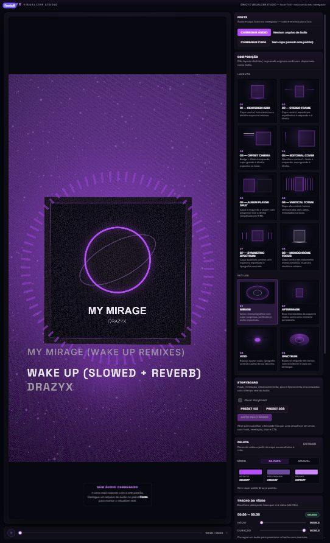
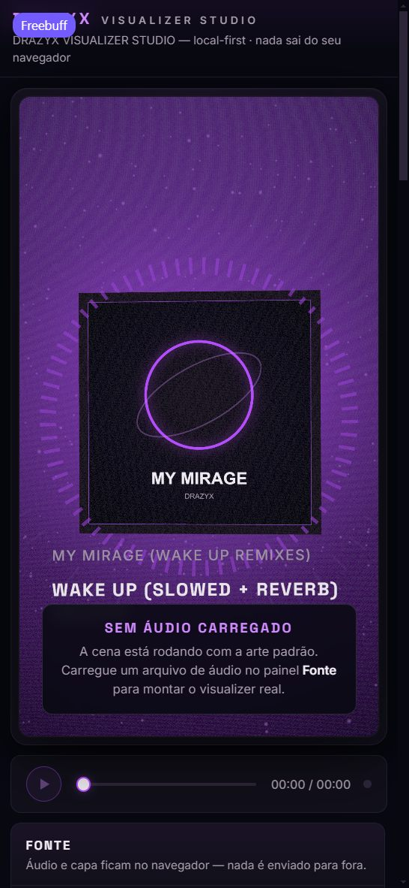
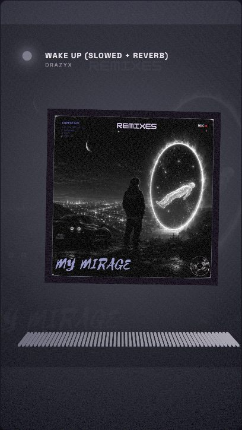
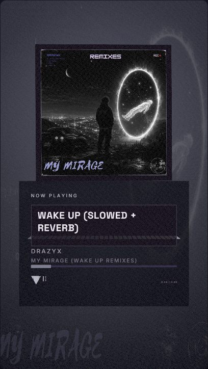
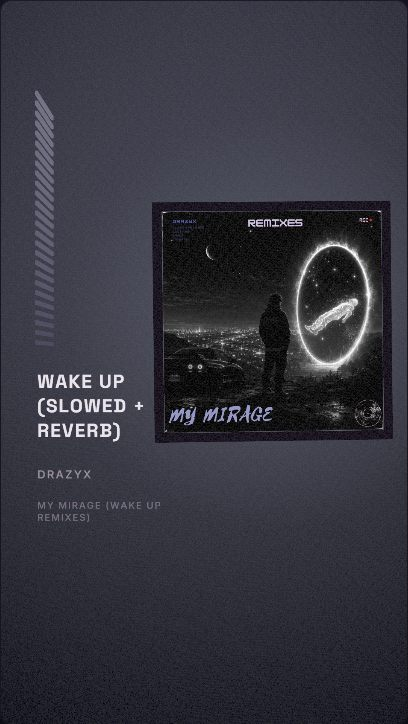

# Auditoria de UI e identidade visual — DRAZYX VISUALIZER STUDIO

Data: 2026-11-25
Método: inspeção visual em sete viewports, medição de layout no DOM, cálculo de
contraste WCAG e comparação de screenshots dos oito cards de layout.

## Impressão geral

A direção de arte é consistente e autoral: preto/roxo, capa central, halos,
partículas, tipografia em caixa alta com tracking, cartões escuros com borda
fina. Não parece um template genérico. O problema não é a identidade; é a
**hierarquia**: o vídeo ocupa pouco espaço útil, o painel concentra decisões
demais e a ação de exportar desaparece no fim da página.

## Hierarquia e composição da tela

Em 1440×900:

- Stage: 407×723 px, mas o quadro que o contém tem 990×761 px. O vídeo usa
  **41% da largura do próprio quadro** e 28,2% da viewport; sobra uma moldura
  escura grande à esquerda.
- Painel: 400×829 px, com **3.581 px de conteúdo** (4,3 telas de rolagem).
- O botão de gravação fica em y≈3.515 px — muito abaixo da dobra.
- No móvel (390×844), o Stage tem 352×626 px (90,3% da largura) e o painel
  começa em y=802; o upload fica em y=874 (fora da primeira tela) e a gravação
  em y=4.205.

A composição visual diz “o vídeo é o herói”, mas o fluxo de trabalho e o CTA
dizem “o painel é o herói”. O olho vai para o Stage; a mão precisa rolar até o
fim do painel.

## Estado vazio

O cartão “SEM ÁUDIO CARREGADO” é visualmente central e **se sobrepõe ao texto
do template** (`emptyOverlapsStage: true` em 1440, 1024 e 390). O texto do Stage
fica ilegível atrás do cartão. O cartão tem borda tracejada, ícone e instrução,
mas ocupa justamente a área onde o usuário deveria entender a composição.

Recomendação: substituir o overlay por um estado integrado ao Stage (moldura
vazia + CTA dentro do quadro) ou posicioná-lo abaixo do título, sem cobrir a
tipografia.

## Tipografia

Contagem no painel (mesma em todos os viewports):

| Tamanho | Ocorrências |
|---|---|
| 9,5 px | 5 |
| 10 px | 15 |
| 10,5 px | 12 |
| 11 px | 44 |
| 12 px | 21 |
| 13 px | 1 |

**76 de 137 textos (55%) estão abaixo de 12 px.** As descrições dos cards
(`.templateDesc`) têm 10,5 px; links e metadados, 11 px. Em 1024×768 e no
móvel, isso fica ainda menor em percepção. O contraste compensa parte do
problema, mas não a leitura prolongada.

A tipografia do vídeo é outro assunto: usa escala grande, caixa alta e bom
contraste; o problema é **colisão**, não tamanho.

## Cores e contraste

Cálculos WCAG sobre os tokens:

| Combinação | Contraste | Uso | Resultado |
|---|---|---|---|
| `#FFFFFF` sobre `#B84DFF` (accent) | **3,79:1** | botões primários, texto 12 px | **Reprova AA** para texto normal |
| `#F2EDF5` sobre `#11101A` | ~16:1 | texto principal | Passa AAA |
| `#A99EAE` sobre `#11101A` | 7,36:1 | texto secundário | Passa AA |
| `#CF8AFF` sobre `#11101A` | 7,85:1 | acento/link | Passa AA |

O botão primário branco sobre roxo claro é o ponto mais fraco: além do
contraste, ele “vaza” para o fundo escuro e perde hierarquia. Uma solução é
accent mais escuro ou texto escuro sobre o roxo.

## Controles e alvos de toque

Medições representativas:

- Botões pequenos (`TROCAR`, `REMOVER`, `EXTRAIR`): 25–31 px de altura.
- Botões segmentados (9:16, 1:1, 16:9): ~31–34 px.
- Slider: trilho fino, thumb ~14 px.
- Cards de layout: 180×201 px (bom), mas com texto interno de 10,5 px.

Abaixo dos 44×44 px recomendados para toque, especialmente no móvel. O foco
por teclado existe e é visível (`outline: solid 2px`), o que é positivo.

## Consistência

Pontos fortes:

- Linguagem de cartões, bordas, raios e sombras uniforme.
- Rótulos em caixa alta, tracking consistente.
- Estados selecionados claros (borda/realce) nos estilos e segmentados.
- Feedback de carregamento e erro em texto legível.

Inconsistências e ruídos:

- **Cards de layout sem estado de erro**: cinco não selecionam e não avisam.
- **“Composição” e “Estilos”** são duas listas de cards visualmente parecidas,
  com funções diferentes (layout × cena). A distinção depende do título da
  seção; não há preview.
- **Nome da seção de gravação** aparece depois de “Tipografia” e “Formato”,
  separada dos demais painéis por um divisor; parece um apêndice.
- **Texto auxiliar**: “Oito layouts distintos” é falso na prática (cinco não
  aplicam) e “Cada template tem seus padrões” não explica o que muda.
- **Estado vazio** cobre o vídeo e usa o mesmo vocabulário do Stage (“SEM ÁUDIO
  CARREGADO”), competindo com o título do template.

## Responsividade

| Viewport | Stage | Painel | Upload visível? | Gravação visível? | Overflow X |
|---|---|---|---|---|---|
| 1920×1080 | vertical, centralizado | ~400 px | sim | não | não |
| 1440×900 | 407×723 | 400×829, scroll 3.581 | sim (y=127) | não (y=3.515) | não |
| 1366×768 | vertical | ~400 px | sim | não | não |
| 1024×768 | 340×604 | 340×703, scroll 3.608 | sim (y=141) | não (y=3.514) | não |
| 768×1024 | vertical, centralizado | empilhado | sim | não | não |
| 390×844 | 352×626 (90%) | 370×3525, página 4.336 | **não (y=874)** | **não (y=4.205)** | não |

O layout não quebra, mas no móvel o Stage sozinho consome a primeira tela
inteira e o painel vira uma página longa. A gravação fica a ~5 telas de
distância. Um CTA fixo (“Gravar”) no rodapé móvel resolveria a descoberta.

## Prévia por formato

- **9:16**: correta (407×723 para canvas 1080×1920, razão 0,562).
- **1:1**: correta (723×723 para 1080×1080).
- **16:9**: **incorreta** — 952×723 (razão 1,317) para canvas 1920×1080
  (razão 1,778). O quadro é esticado na horizontal; a composição avaliada não
  é a que será gravada. Causa: `.stageInner` tem `height:100%` e
  `max-width:100%`; quando a largura calculada excede o limite, só a largura é
  cortada, sem reajustar a altura. Ver BUG-02.

## Qualidade visual dos templates (capturas)

Os screenshots `layout-1` a `layout-8` mostram:

- **T1/T2**: praticamente idênticos; T2 promete waveforms espelhadas que quase
  não aparecem. A hierarquia é boa, mas a diferença é insuficiente.
- **T3**: editorial, capa grande à direita, texto à esquerda; tem “REMIXES” e
  “MY MIRAGE” fantasma atrás do texto, competindo com a leitura.
- **T4**: metade inferior vazia; a composição fica desequilibrada para cima.
- **T5**: player split funciona, mas “MY MIRAGE” fantasma no rodapé parece
  watermark acidental.
- **T6/T7/T8**: não são templates reais no deploy — a captura é o T5, porque o
  clique não aplica (BUG-01).

## Sobreposição de texto no template padrão

No T1 (MIRAGE) com o conteúdo padrão, “WAKE UP (SLOWED + REVERB)” quebra em
duas linhas e a segunda linha colide com “DRAZYX”. Na captura de export
(`evidence/flow-03-export-preview.jpg`) a colisão é visível no arquivo
pré-visualizado. É um problema de **layout de texto**, não de fonte: as posições
são fixas e não há medição/colisão. Prioridade P1 porque afeta o caminho padrão
e o arquivo final.

## Recomendações de UI (por impacto)

1. **Transformar “Gravar trecho” em CTA persistente** (barra inferior no
   desktop, botão fixo no móvel), com estado “Gravar 5 s” e progresso.
2. **Corrigir o Stage**: usar `max-height:100%`, `width:auto` e um contêiner
   com `aspect-ratio` correto; nunca cortar só a largura. Testar 16:9 em
   1440×900 e viewport alta.
3. **Redesenhar o estado vazio** para não cobrir o texto e incluir CTA dentro
   do Stage.
4. **Reduzir a densidade**: pelo menos 12 px para texto auxiliar, 44 px para
   alvos, agrupar sliders avançados em “Avançado”.
5. **Dar previews reais** aos 8 layouts e 4 estilos; desabilitar/rotular os
   indisponíveis até corrigir.
6. **Adicionar régua/guia de área segura** no Stage (9:16) e corrigir a prévia
   16:9 antes de oferecê-la.
7. **Unificar “Composição” e “Estilos”** em um seletor com duas abas e
   thumbnails, reduzindo a carga cognitiva.

## Conclusão

A UI tem personalidade e coerência suficientes para um produto premium; o que
a impede de parecer pronta é a **hierarquia funcional** (CTA escondido, Stage
subutilizado), a **legibilidade** (texto pequeno, sobreposições) e duas falhas
de apresentação (16:9 esticado, cinco cards mortos). O polimento visual deve
vir depois dessas correções, não antes.
